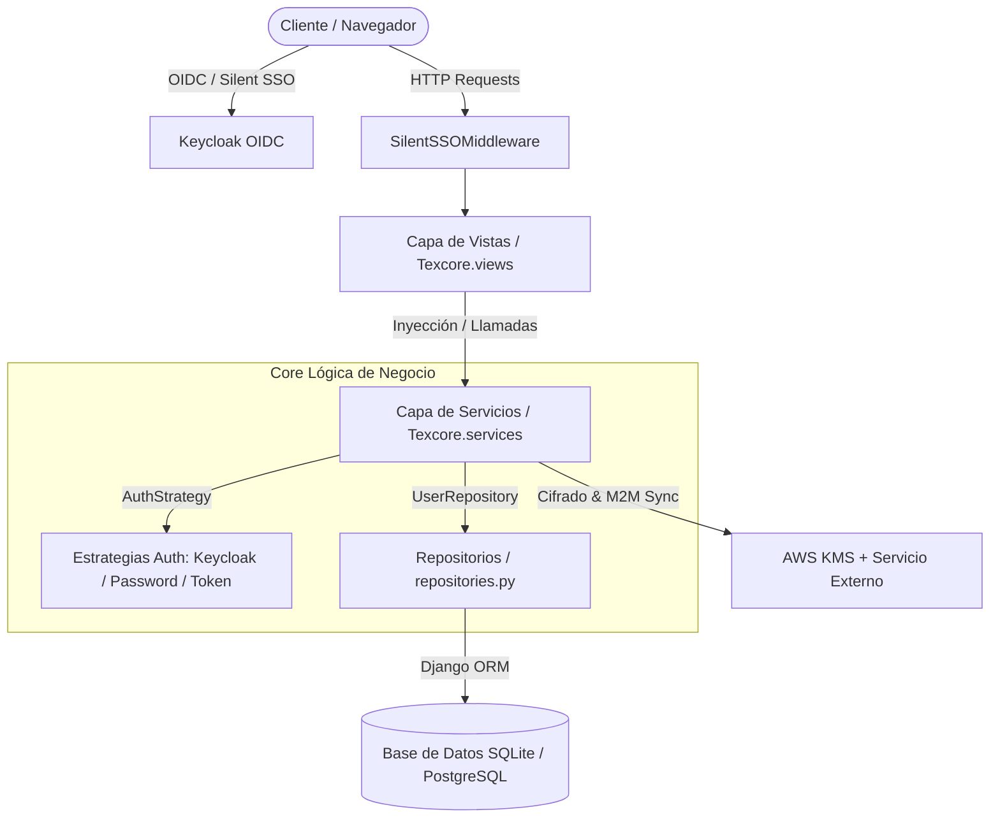

# 🧵 Textil-APP (Texcore)


Sistema integral para el control, trazabilidad y gestión de procesos de producción textil. Diseñado bajo principios **SOLID** y **Clean Architecture** (Capa de Servicios, Patrón Estrategia y Patrón Repositorio) para permitir el seguimiento riguroso del inventario de materia prima, fases de preparación, transformación en hilatura y sincronización segura entre sistemas.

---

## 📐 Arquitectura del Sistema

El proyecto separa la capa de presentación (Vistas/Templates), la lógica de negocio (Servicios), las estrategias de autenticación y el acceso a datos (Repositorios / ORM):



### Patrones de Diseño Implementados
- **Service Layer (`Texcore/services/`):** Aísla toda la lógica de negocio de las vistas HTTP (`auth_service.py`, `materia_service.py`, `preparacion_service.py`, `hilatura_service.py`, `dashboard_service.py`, `kms_sync_service.py`).
- **Strategy Pattern (`Texcore/services/auth_strategies.py`):** Define la interfaz `AuthStrategy` con implementaciones intercambiables (`KeycloakStrategy`, `PasswordStrategy`, `TokenStrategy`).
- **Repository Pattern (`Texcore/services/repositories.py`):** Abstrae las consultas de usuarios mediante `UserRepository` y su implementación `DjangoUserRepository` (cumpliendo ISP y DIP).
- **Decoradores RBAC (`Texcore/decorators.py`):** Control de acceso declarativo por rol (`@admin_required`, `@preparador_required`, `@operario_required`, `@admin_or_preparador_required`, `@admin_or_operario_required`).

---

## ✨ Características Principales

1. **Gestión de Materia Prima (`Materia`):**
   - Control de inventarios iniciales (algodón, seda, lana, poliéster, etc.), cantidades, unidades de medida, lotes y trazabilidad de usuario/fecha de ingreso.
   - Sincronización cifrada hacia sistemas externos mediante **AWS KMS** y **Keycloak Client Credentials**.
2. **Fase de Preparación (`PreparacionMateria` y `DetallePreparacion`):**
   - Registro y monitoreo de procesos previos: *Limpieza*, *Apertura*, *Mezclado* y *Ajuste de Proporciones*.
   - Control de estados (*Pendiente*, *En Proceso*, *Completada*, *Rechazada*), cálculo de duración, porcentaje de mezcla, temperatura, humedad, equipo utilizado, rendimiento, merma y calificación de calidad.
   - Generación de reportes estadísticos de preparación.
3. **Fase de Hilatura (`ProcesoHilatura` y `DetalleHilatura`):**
   - Control secuencial de las etapas de transformación de fibra a hilo: *Cardado*, *Peinado* e *Hilado*.
   - Vinculación directa con la preparación de origen, control de fibra de entrada vs. hilo de salida, cálculo automático de rendimiento (`%`) y merma (`%`).
   - Parámetros técnicos detallados: título del hilo (`Ne`, `Nm`, `Tex`), torsión (`TPM`), resistencia (`cN/tex`), velocidad de máquina, número de husos, uniformidad y registro de defectos.
4. **Autenticación Centralizada (Keycloak OIDC & Silent SSO):**
   - Inicio de sesión federado con **Keycloak** (`KeycloakManager`).
   - **SSO Silencioso (`SilentSSOMiddleware`):** Verifica automáticamente si existe una sesión activa en Keycloak al navegar por la aplicación, autenticando al usuario de forma transparente.
5. **Control de Acceso Basado en Roles (RBAC):**
   - Sincronización automática de roles de cliente y de realm desde el token JWT de Keycloak hacia el modelo local `Profile`.
   - Dashboards personalizados y vistas protegidas para cada rol (`admin`, `preparador`, `operario`).
6. **Seguridad y Cifrado con AWS KMS (`KMSManager`):**
   - Cifrado y descifrado de cargas útiles (payloads JSON en Base64) utilizando llaves maestras en AWS KMS (`boto3`) para transmisión segura entre microservicios/sistemas.

---

## 🗃️ Modelos de Datos

| Modelo | Descripción | Relaciones Clave |
| :--- | :--- | :--- |
| **`Profile`** | Extiende el modelo `User` de Django con el rol (`admin`, `preparador`, `operario`). | `OneToOneField(User)` |
| **`Materia`** | Lotes de materia prima en inventario (tipo, cantidad, unidad, lote, fecha). | `ForeignKey(User)` (`usuario_registro`) |
| **`PreparacionMateria`** | Proceso de preparación sobre una materia prima (limpieza, apertura, mezclado, ajuste). | `ForeignKey(Materia)`, `ForeignKey(User)` |
| **`DetallePreparacion`** | Parámetros técnicos de preparación (temperatura, humedad, tiempo, equipo, merma, rendimiento). | `ForeignKey(PreparacionMateria)` |
| **`ProcesoHilatura`** | Transformación en etapas (*cardado*, *peinado*, *hilado*), fibra entrada vs. hilo salida. | `ForeignKey(PreparacionMateria)`, `ForeignKey(User)` |
| **`DetalleHilatura`** | Parámetros de maquinaria de hilatura (velocidad, husos, torsión, uniformidad, defectos). | `ForeignKey(ProcesoHilatura)` |

---

## 👥 Roles y Permisos (RBAC)

| Módulo / Funcionalidad | `admin` (Administrativo) | `preparador` (Preparador) | `operario` (Operario) |
| :--- | :---: | :---: | :---: |
| **Dashboard Específico** | ✅ (`/dashboard/admin/`) | ✅ (`/dashboard/preparador/`) | ✅ (`/dashboard/operario/`) |
| **Gestión de Usuarios (`/usuarios/`)** | ✅ CRUD Completo | ❌ | ❌ |
| **Materias Primas (`/materias/`)** | ✅ CRUD + Sincronización KMS | ✅ Consulta | ✅ CRUD |
| **Preparación (`/preparaciones/`)** | ✅ CRUD + Reportes | ✅ CRUD + Iniciar/Completar + Reportes | ❌ |
| **Hilatura (`/hilaturas/`)** | ✅ CRUD + Reportes | ❌ | ✅ CRUD + Iniciar/Completar + Reportes |
| **Demo Cifrado KMS (`/kms-demo/`)** | ✅ | ✅ | ✅ |

---

## 📂 Estructura del Proyecto

```text
Textil-APP/
├── LoginCRUD/                  # Configuración principal del proyecto Django
│   ├── settings/
│   │   ├── base.py             # Configuración base (Apps, Middleware, Templates, Static)
│   │   ├── development.py      # Entorno de desarrollo local
│   │   └── production.py       # Entorno de producción (Render / WhiteNoise / Seguridad)
│   ├── asgi.py
│   ├── urls.py                 # Enrutador raíz
│   └── wsgi.py
├── Texcore/                    # Aplicación principal del dominio textil
│   ├── management/commands/    # Comandos personalizados (ej. crear_usuario)
│   ├── migrations/             # Migraciones de base de datos
│   ├── services/               # Capa de Servicios y Arquitectura Limpia
│   │   ├── auth_service.py     # Servicio de autenticación (DIP)
│   │   ├── auth_strategies.py  # Estrategias: KeycloakStrategy, PasswordStrategy, TokenStrategy
│   │   ├── dashboard_service.py# Métricas y estadísticas por rol
│   │   ├── hilatura_service.py # Lógica de negocio para procesos de hilatura
│   │   ├── kms_sync_service.py # Sincronización cifrada con AWS KMS + OIDC Client Credentials
│   │   ├── materia_service.py  # Lógica de negocio para inventario de materia prima
│   │   ├── preparacion_service.py # Lógica de negocio para preparación de fibras
│   │   └── repositories.py     # Patrón Repositorio (UserRepository, DjangoUserRepository)
│   ├── views/                  # Capa de Presentación dividida por dominio
│   │   ├── auth_views.py       # Login, Callback OIDC, Logout
│   │   ├── dashboard_views.py  # Dashboards por rol y KMS demo
│   │   ├── hilatura_views.py   # Vistas CRUD, estados y reportes de hilatura
│   │   ├── materia_views.py    # Vistas CRUD y sincronización de materia prima
│   │   ├── preparacion_views.py# Vistas CRUD, estados y reportes de preparación
│   │   └── user_views.py       # Administración de usuarios y perfiles
│   ├── static/                 # Archivos CSS, JS e imágenes
│   ├── templates/              # Plantillas HTML del sistema
│   ├── decorators.py           # Decoradores de autorización por rol
│   ├── forms.py                # Formularios y validaciones Django
│   ├── middleware.py           # SilentSSOMiddleware para Keycloak
│   ├── models.py               # Modelos de datos (Profile, Materia, Preparacion, Hilatura)
│   ├── security.py             # Clientes KeycloakManager y KMSManager (AWS KMS)
│   └── urls.py                 # Rutas de la aplicación Texcore
├── docs/                       # Documentación adicional, backlog y reportes de seguridad
├── Dockerfile                  # Imagen Docker para despliegue
├── docker-compose.yml          # Orquestación local (PostgreSQL + Keycloak + Vault + App)
├── entrypoint.sh               # Script de arranque para contenedor en producción
├── init_data.py                # Script generador de datos de muestra (usuarios y materias)
├── start_local.bat             # Script rápido de inicio en Windows
├── requirements.txt            # Dependencias de Python
├── .env.example                # Plantilla de variables de entorno
├── DEPLOYMENT.md               # Guía detallada de despliegue en Render
└── DEMO_GUIDE.md               # Guion paso a paso para demostraciones
```

---

## 🌐 Rutas Principales (Endpoints)

| Ruta | Nombre URL | Descripción |
| :--- | :--- | :--- |
| `/` o `/inicio/` | `inicio` | Página de bienvenida / redirección inicial |
| `/keycloak/login/` | `keycloak_login` | Inicia el flujo OIDC redirigiendo a Keycloak |
| `/keycloak/callback/` | `keycloak_callback` | Recibe el código de autorización OIDC y sincroniza roles |
| `/logout/` | `logout` | Cierra sesión local en Django y global en Keycloak |
| `/libros/` | `index` | Redireccionador automático al dashboard según el rol del usuario |
| `/dashboard/admin/` | `admin_dashboard` | Panel de control administrativo |
| `/dashboard/preparador/` | `preparador_dashboard` | Panel de control para preparadores |
| `/dashboard/operario/` | `operario_dashboard` | Panel de control para operarios |
| `/materias/` | `index_materia` | Listado, creación, edición, eliminación y sincronización KMS de materias |
| `/preparaciones/` | `listar_preparaciones` | Gestión del ciclo de vida de preparación de fibras y reportes |
| `/hilaturas/` | `listar_hilaturas` | Gestión del ciclo de vida de hilatura (cardado, peinado, hilado) y reportes |
| `/usuarios/` | `listar_usuarios` | Gestión de usuarios del sistema (exclusivo `admin`) |
| `/kms-demo/` | `kms_demo` | Prueba interactiva de cifrado y envío con AWS KMS |

---

## 🛠️ Requisitos Previos

- **Python:** 3.11 o superior.
- **Keycloak:** Instancia activa de Keycloak (local vía Docker o servidor remoto).
- **AWS KMS (Opcional):** Credenciales IAM y ARN de llave KMS para las funciones de cifrado entre servicios.
- **Docker & Docker Compose (Opcional):** Para levantar todo el ecosistema en contenedores.

---

## ⚙️ Configuración y Ejecución en Entorno Local

### Opción A: Ejecución Nativa en Windows / Linux / macOS

1. **Clonar el repositorio:**
   ```bash
   git clone <url-del-repositorio>
   cd Textil-APP
   ```

2. **Crear entorno virtual e instalar dependencias:**
   ```powershell
   python -m venv .venv
   .\.venv\Scripts\Activate.ps1   # En Windows (PowerShell)
   # source .venv/bin/activate    # En Linux / macOS
   pip install -r requirements.txt
   ```

3. **Configurar las variables de entorno (`.env`):**
   Copia el archivo `.env.example` a `.env` en la raíz del proyecto y ajusta tus valores:
   ```env
   # Configuración Django
   DEBUG=True
   SECRET_KEY=tu_clave_secreta_django
   DJANGO_SETTINGS_MODULE=LoginCRUD.settings.development

   # Configuración de Keycloak (OIDC)
   KEYCLOAK_URL=http://localhost:8080
   KC_REALM=textil-realm
   KC_CLIENT_ID=textil-app-a
   KC_CLIENT_SECRET=tu-client-secret-de-keycloak

   # Configuración AWS KMS y Sincronización Externa (Opcional)
   AWS_ACCESS_KEY_ID=tu_access_key
   AWS_SECRET_ACCESS_KEY=tu_secret_key
   AWS_REGION_NAME=us-east-1
   AWS_KMS_KEY_ARN=arn:aws:kms:us-east-1:123456789012:key/tu-key-id
   CATEQUESIS_API_URL=http://localhost:8001/api/v1/sync-textil/
   ```

4. **Aplicar migraciones e inicializar datos:**
   ```bash
   python manage.py migrate
   python init_data.py          # (Opcional) Carga materias y usuarios de prueba
   python manage.py runserver
   ```
   > 💡 **Atajo en Windows:** Puedes ejecutar directamente `start_local.bat`, el cual aplica migraciones, recolecta estáticos, crea los usuarios base (`admin` / `operario`) y levanta el servidor en `http://127.0.0.1:8000/`.

---

### Opción B: Ejecución con Docker Compose

El archivo `docker-compose.yml` levanta un entorno completo con:
- **PostgreSQL 15** (`db` en el puerto `5432`)
- **Keycloak 24.0** (`keycloak` en el puerto `8080`)
- **HashiCorp Vault** (`vault` en el puerto `8200`)
- **Textil-APP** (`sistema_a` en el puerto `8001`)

```bash
docker-compose up --build
```

---

## 🔐 Configuración Requerida en Keycloak

Para que el inicio de sesión OIDC, el **Silent SSO** y la sincronización de roles funcionen correctamente, configura en tu instancia de Keycloak:

1. **Realm:** `textil-realm` (o el nombre indicado en `KC_REALM`).
2. **Client:** `textil-app-a` (o el indicado en `KC_CLIENT_ID`):
   - **Client Authentication (Access Type):** `On` (*Confidential*).
   - **Standard Flow Enabled:** `On`.
   - **Service Accounts Roles (Client Credentials):** `On` (necesario para la sincronización M2M con KMS).
   - **Valid Redirect URIs:**
     - `http://localhost:8000/keycloak/callback/*`
     - `http://127.0.0.1:8000/keycloak/callback/*`
   - **Valid Post Logout Redirect URIs:**
     - `http://localhost:8000/*`
     - `http://127.0.0.1:8000/*`
   - **Web Origins:** `*` o `http://localhost:8000`
3. **Scopes Requeridos:** `openid`, `profile`, `email`.
4. **Roles (Client Roles o Realm Roles):**
   - Crear los roles exactos: `admin`, `preparador`, `operario`.
   - Asignar el rol correspondiente a cada usuario en Keycloak (al iniciar sesión, `KeycloakStrategy` sincroniza automáticamente el rol con el modelo `Profile` de Django).

---

## 🚀 Despliegue en Producción (Render / Docker)

El proyecto incluye soporte listo para producción mediante `Dockerfile`, `entrypoint.sh`, `Gunicorn` y `WhiteNoise`:
- Revisa la guía detallada en [`DEPLOYMENT.md`](./DEPLOYMENT.md) para instrucciones paso a paso de despliegue en **Render**.
- Revisa [`DEMO_GUIDE.md`](./DEMO_GUIDE.md) para consultar el guion de presentación y demostración funcional del sistema.
