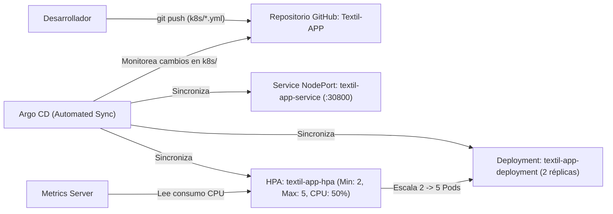

# 🚀 Informe Técnico: Despliegue de Textil-APP con Argo CD y Kubernetes (GitOps + HPA)

**Asignatura:** Contenedores y Orquestación (Kubernetes & GitOps)  
**Aplicación Desplegada:** Textil-APP (Texcore - Django 5.2 + Gunicorn)  
**Repositorio Público (Fuente de Verdad):** `[INSERTAR_LINK_DE_TU_REPOSITORIO_PUBLICO_AQUI]`  
**Ruta de Manifiestos en el Repositorio:** `k8s`  

---

## 1. Introducción y Objetivo

El presente informe documenta la implementación de un flujo **GitOps** en **Kubernetes** utilizando **Argo CD** como controlador de entrega continua para desplegar el sistema **Textil-APP (Texcore)**, tomando su repositorio público de **GitHub** como única fuente de verdad (*Single Source of Truth*).

El despliegue contempla tres recursos fundamentales sincronizados automáticamente por Argo CD desde la carpeta `k8s/`:
1. **Deployment (`k8s/deployment.yml`):** Despliega la aplicación web **Textil-APP** (`textil-app:v1`) con **2 réplicas iniciales**, selectores de etiquetas (`app: textil-app`), puerto expuesto (`8000`) y configuración de `requests` y `limits` de CPU y memoria.
2. **Service (`k8s/service.yml`):** Expone **Textil-APP** mediante un servicio tipo **`NodePort`** (`8000:30800/TCP`) con afinidad de sesión (`ClientIP`).
3. **Horizontal Pod Autoscaler (`k8s/hpa.yml`):** Escala automáticamente los Pods de **Textil-APP** entre un **mínimo de 2** y un **máximo de 5 réplicas** cuando la utilización promedio de CPU supera el **50%**.

---

## 2. Arquitectura GitOps Implementada



---

## 3. Manifiestos Configurados (`k8s/`)

### 3.1. Deployment (`k8s/deployment.yml`)
Cumple con:
- **2 réplicas iniciales** (`replicas: 2`).
- **Etiquetas y selectores** (`app: textil-app`, `tier: web`).
- **Requests y Limits:** CPU (`100m` request / `300m` limit) y Memoria (`128Mi` request / `256Mi` limit), indispensables para que el `Metrics Server` calcule el porcentaje de uso para el HPA.
- **Puerto expuesto:** `containerPort: 8000` (Gunicorn / Django).

```yaml
apiVersion: apps/v1
kind: Deployment
metadata:
  name: textil-app-deployment
  labels:
    app: textil-app
    tier: web
spec:
  replicas: 2
  selector:
    matchLabels:
      app: textil-app
  strategy:
    type: RollingUpdate
    rollingUpdate:
      maxSurge: 1
      maxUnavailable: 0
  template:
    metadata:
      labels:
        app: textil-app
        tier: web
    spec:
      containers:
        - name: textil-app
          image: textil-app:v1
          imagePullPolicy: IfNotPresent
          ports:
            - name: http
              containerPort: 8000
              protocol: TCP
          env:
            - name: DJANGO_SETTINGS_MODULE
              value: "LoginCRUD.settings.production"
            - name: DEBUG
              value: "False"
          resources:
            requests:
              cpu: "100m"
              memory: "128Mi"
            limits:
              cpu: "300m"
              memory: "256Mi"
```

### 3.2. Service (`k8s/service.yml`)
Cumple con:
- **Tipo `NodePort`** (`nodePort: 30800`).
- **Puertos:** `port: 8000` y `targetPort: 8000`.
- **Selector:** Asociado a los Pods con `app: textil-app`.
- **Persistencia de Sesión:** `sessionAffinity: ClientIP` para mantener la sesión de usuario en Django entre las réplicas.

```yaml
apiVersion: v1
kind: Service
metadata:
  name: textil-app-service
  labels:
    app: textil-app
    tier: web
spec:
  type: NodePort
  sessionAffinity: ClientIP
  sessionAffinityConfig:
    clientIP:
      timeoutSeconds: 10800
  selector:
    app: textil-app
  ports:
    - name: http
      protocol: TCP
      port: 8000
      targetPort: 8000
      nodePort: 30800
```

### 3.3. Horizontal Pod Autoscaler (`k8s/hpa.yml`)
Cumple con:
- **Mínimo de réplicas:** `minReplicas: 2`.
- **Máximo de réplicas:** `maxReplicas: 5`.
- **Objetivo de CPU:** `averageUtilization: 50` (50%).
- **Asociación:** `scaleTargetRef` apuntando al Deployment `textil-app-deployment`.

```yaml
apiVersion: autoscaling/v2
kind: HorizontalPodAutoscaler
metadata:
  name: textil-app-hpa
  labels:
    app: textil-app
spec:
  scaleTargetRef:
    apiVersion: apps/v1
    kind: Deployment
    name: textil-app-deployment
  minReplicas: 2
  maxReplicas: 5
  metrics:
    - type: Resource
      resource:
        name: cpu
        target:
          type: Utilization
          averageUtilization: 50
```

---

## 4. Guía Paso a Paso y Evidencias de Ejecución

### Paso 1: Construir la imagen de Textil-APP dentro de Minikube
Desde PowerShell en la carpeta `D:\Proyectos\Textil-APP`, construimos la imagen `textil-app:v1` directamente en el nodo de Minikube para que el clúster la tenga disponible de inmediato:

```powershell
cd D:\Proyectos\Textil-APP
minikube image build -t textil-app:v1 .
minikube image ls | Select-String "textil-app"
```

> 📸 **[INSERTAR CAPTURA #1 AQUÍ]:** Imagen `textil-app:v1` construida y registrada dentro de Minikube.

---

### Paso 2: Subir los cambios a GitHub (Commit & Push)
1. Abre **GitHub Desktop** en el repositorio `Textil-APP`.
2. Haz **Commit to main** y luego **Push origin**.
3. Como **Argo CD** tiene activado **Automated Sync (`Prune` + `Self Heal`)**, detectará automáticamente el nuevo commit en `k8s/` y reemplazará los recursos anteriores por **`textil-app-deployment`**, **`textil-app-service`** y **`textil-app-hpa`**.

> 📸 **[INSERTAR CAPTURA #2 AQUÍ]:** Repositorio público en GitHub mostrando `k8s/deployment.yml`, `k8s/service.yml` y `k8s/hpa.yml`.

---

### Paso 3: Sincronización Automática en Argo CD
En el panel de **Argo CD** (`https://localhost:8080`), haz clic en **`REFRESH`** (o **`SYNC`**). Verás cómo Argo CD sincroniza automáticamente el nuevo commit de `Textil-APP` y crea:
- `textil-app-deployment` con **2 Pods** (`Running`).
- `textil-app-service` (`NodePort`).
- `textil-app-hpa` (`Healthy`).

> 📸 **[INSERTAR CAPTURA #3 AQUÍ]:** Árbol de la aplicación en **Argo CD** en estado `Healthy` y `Synced` mostrando `textil-app-deployment`, `textil-app-service`, `textil-app-hpa` y los **2 Pods** de Textil-APP.

---

### Paso 4: Verificar los recursos y abrir Textil-APP en el navegador
En PowerShell, verifica los recursos creados por Argo CD:

```powershell
kubectl get deploy,rs,pods,svc,hpa -l app=textil-app -o wide
```

> 📸 **[INSERTAR CAPTURA #4 AQUÍ]:** Salida de consola mostrando el Deployment (`2/2`), el Service `NodePort` (`8000:30800/TCP`) y el HPA (`MINPODS: 2`, `MAXPODS: 5`).

Ahora abre el túnel para acceder a **Textil-APP** en tu navegador:

```powershell
kubectl port-forward svc/textil-app-service 8000:8000
```

Abre en tu navegador: **`http://localhost:8000`**
- Puedes iniciar sesión en **Textil-APP** con los usuarios que crea automáticamente el contenedor:
  - **Admin:** `admin` / `admin123`
  - **Operario:** `operario` / `operario123`
  - **Preparador:** `preparador` / `preparador123`

> 📸 **[INSERTAR CAPTURA #5 AQUÍ]:** Interfaz web de **Textil-APP (Texcore)** funcionando en el navegador desde Kubernetes (`http://localhost:8000`).

---

### Paso 5: Prueba del Horizontal Pod Autoscaler (Escalamiento de 2 a 5 réplicas de Textil-APP)

1. En una terminal de PowerShell, lanza un generador de carga contra `textil-app-service:8000`:
   ```powershell
   kubectl run -i --tty load-generator --rm --image=busybox:1.28 --restart=Never -- /bin/sh -c "while true; do wget -q -O- http://textil-app-service:8000/login/ > /dev/null; done"
   ```
2. En otra terminal, observa cómo sube el porcentaje de CPU en el HPA y cómo escala de **2 a 5 réplicas**:
   ```powershell
   kubectl get hpa textil-app-hpa --watch
   ```
3. Cuando las réplicas suban a **5**, verifica los Pods:
   ```powershell
   kubectl get pods -l app=textil-app
   ```

> 📸 **[INSERTAR CAPTURA #6 AQUÍ]:** Consola mostrando `kubectl get hpa` con CPU > 50% y los **5 Pods** de `textil-app` en ejecución.

> 📸 **[INSERTAR CAPTURA #7 AQUÍ]:** Interfaz de **Argo CD** mostrando en tiempo real los **5 Pods** de `textil-app-deployment` creados por el HPA.

---

## 5. Conclusiones

1. **Despliegue GitOps de Textil-APP:** Argo CD sincronizó de forma automática la aplicación Django/Gunicorn directamente desde el repositorio GitHub, aplicando cualquier cambio en los manifiestos sin intervención manual.
2. **Escalabilidad Automática con HPA:** Gracias a la configuración de `requests.cpu: 100m` y `Metrics Server`, el `HorizontalPodAutoscaler` detectó la carga generada sobre las vistas de Django y escaló horizontalmente `textil-app-deployment` de **2 a 5 Pods**.
3. **Exposición y Persistencia de Sesión:** El servicio `NodePort` con `sessionAffinity: ClientIP` permitió navegar e iniciar sesión en **Textil-APP** sin pérdida de sesión entre las réplicas activas.
